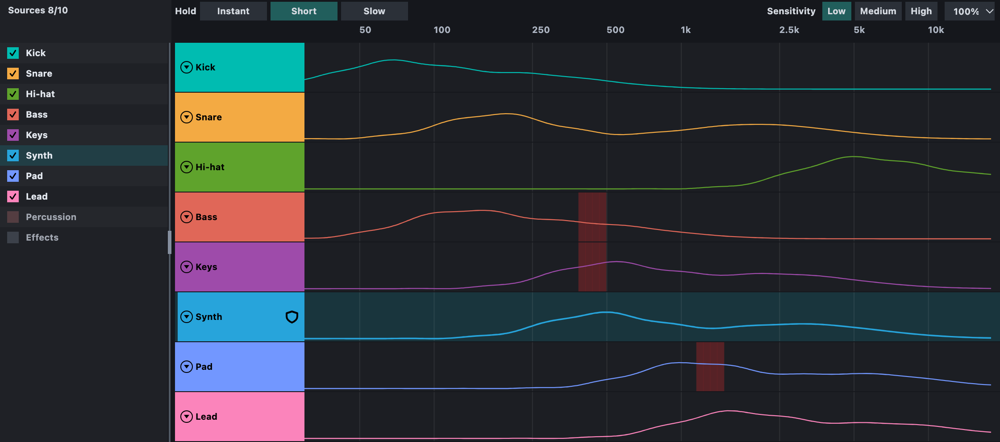

# FreqFriction

FreqFriction is a Max for Live device that helps you find where one track may make another harder to hear. Choose the sound you want to follow and watch which other tracks light up as the mix plays.

## Find a potential clash

1. Load [FreqFriction.amxd](FreqFriction.amxd) in Ableton Live and click **Float** to open the monitor.
2. Select the tracks you want to compare in the left column. In the graph, click the name of the track you want to hear clearly. The shield marks it as the **protected track**.
3. Play the passage. Each curve shows one track’s spectrum. A red band on another track’s row marks the frequency range where that track may be masking the protected sound.

**Sensitivity** controls how strong the evidence of a clash must be for a warning to appear. **Hold** keeps brief warnings visible long enough to inspect. For larger sets, [FreqFriction Input](FreqFriction%20Input.amxd) adds 31 stereo inputs to the main device.

## How the detector works

FreqFriction compares each selected source with the protected track, one pair at a time. A longer spectral analysis locates the frequency bands where both sounds have energy. Shorter windows then check whether that energy occurs at the same time and how loud the competing sound is relative to the protected sound. This makes the comparison directional. A loud kick may obscure a quiet bass note more readily than the bass note obscures the kick.

In the low end, the detector also follows how the energy in each track rises and falls. A kick and a bass note that alternate can occupy much the same frequency range over a whole beat. Their different timing gives the detector a reason to reduce the warning.

## What the highlights mean

The design draws on two findings from hearing research. Our ability to separate nearby frequencies varies across the spectrum, including in the bass. The timing of a competing sound also affects how easily we hear a target sound. These principles motivate checking both frequency and timing. [Jurado & Moore, *Frequency selectivity for frequencies below 100 Hz*](https://pubmed.ncbi.nlm.nih.gov/21218891/) · [Plack & Moore, *Temporal window shape as a function of frequency and level*](https://pubmed.ncbi.nlm.nih.gov/2348022/)

FreqFriction uses its own scoring rules to turn those measurements into highlights. The studies describe human hearing under controlled conditions. How well a highlight predicts an audible clash in your mix is a separate question. Use it to choose a passage to audition, then listen with both tracks playing to decide whether the overlap serves the mix.

## Build from source

Run `python3 src/build.py` to build both devices. Run `node tests/band-overlap.cjs` to check the detector with synthetic audio.
